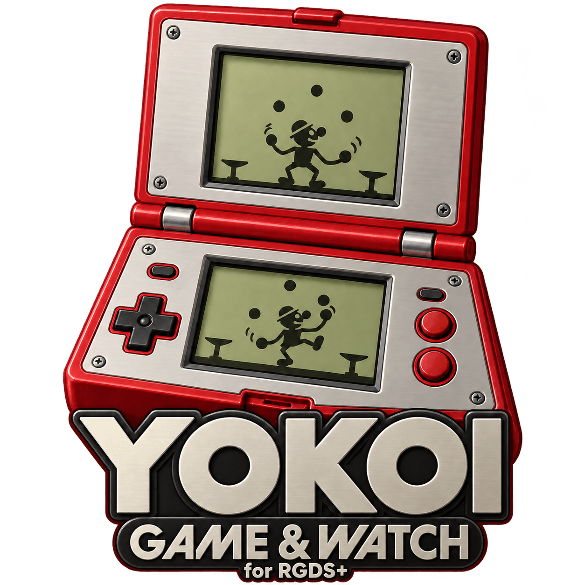

# Yokoi: Game & Watch Emulator — RGDS+ Edition

  

[](https://github.com/PolluxPT/Yokoi-RGDSPlus/releases/latest)

**No ROMs included.** Create your own pack using the original project's instructions.

**[English](README.md) | [Português](README.pt-PT.md)**

Native standalone port of Yokoi for **Anbernic RGDS+ Stock OS (Linux ARM64)**.
Version **1.1**. This is a Linux port; it is not the upstream Android APK.

Original emulator by **RetroValou**: [https://github.com/RetroValou/Yokoi_Game_-_Watch_emulator_3ds](https://github.com/RetroValou/Yokoi_Game_-_Watch_emulator_3ds).
RGDS+ adaptation project: **Filipe Baeta**, developed with assistance from ChatGPT/Codex.
Upstream base revision: `f273025`.

## No ROMs included

This repository and its release packages do **not** include game ROMs, ROM packs,
original game artwork or personal save states. Users must supply their own
compatible pack. No game download links are provided.

## Build your own game pack

Use **RetroValou's original project and instructions** to prepare your own pack:

- [Original Yokoi project](https://github.com/RetroValou/Yokoi_Game_-_Watch_emulator_3ds)
- [CONVERT_ROM instructions — including Android (RGDS)](https://github.com/RetroValou/Yokoi_Game_-_Watch_emulator_3ds/blob/main/CONVERT_ROM/README.md#android-rgds)

For this Linux port, follow the **Android (RGDS)** target in that guide and
produce **`yokoi_pack_rgds.ykp`**. After completing the upstream prerequisites,
the documented conversion commands, from `CONVERT_ROM`, are:

```sh
python convert_original.py --target rgds
python convert_3ds.py --target rgds
```

Copy the result to `Roms/APPS/Yokoi_RGDSPlus/yokoi_pack_rgds.ykp` on the SD card.
The **3DS pack is not supported**. Do not upload your generated pack here.

## Features

- Two-screen SDL2 rendering and corrected Panorama mask backgrounds.
- PT/EN interface, blue menus, advanced options and controller calibration.
- Touch swipe to browse; double tap for GAME A.
- L1/R1 alphabetic jumps; L2/R2 game-screen swap.
- Calibrated Anbernic R button for Pause; START+SELECT fallback.
- Three manual save-state slots per game and slot deletion management.
- Exit/delete confirmation; GAME A/B restart through Pause.
- Volume buttons and smooth low-volume curve.
- Lazy loading of emulation textures to reduce menu startup work.

## Installation — update package

The downloadable v1.1 release is an **update for an existing working RGDS+ Linux
installation**. It does not include runtime libraries or a game pack.

1. Extract the release ZIP and copy `Roms` to the SD-card root; replace the app files.
2. Keep your existing `Yokoi_RGDSPlus/lib`, pack, configuration files and `saves`.
3. Place your own `yokoi_pack_rgds.ykp` beside the `yokoi` executable if not already there.
4. Launch `Yokoi` from APPS and follow the calibration if requested.

Fresh installations also require a compatible ARM64 runtime. The supplied
binary uses SDL2 and requires up to GLIBC_2.38 and GLIBCXX_3.4.31. The matching
runtime libraries are **not distributed in this release**; see `linux/README.md`.

## Controls

| Screen | Control | Action |
|---|---|---|
| Game list | D-pad / touchscreen swipe | Browse games |
| Game list | A / START / double tap | GAME A |
| Game list | SELECT | GAME B |
| Game list | Y | Load an occupied save slot |
| Game list | L1 / R1 | Previous / next initial |
| Game list | X | Advanced options: language, buttons, back |
| Game list | R | Confirm exit |
| Gameplay | R or START+SELECT | Pause |
| Gameplay | L2 / R2 | Swap game screens |
| Pause | Up / Down; A; B | Select; confirm; resume |
| Pause | Left / Right | Save-slot selection |
| Slot manager | D-pad; A; B | Select slot; request deletion; back |

GAME A and GAME B retain the original hardware wording in both languages.
If firmware does not expose R, calibration can be skipped by holding START+SELECT.

## Build the Linux executable

On Debian/Ubuntu install a C++20 compiler and SDL2 development files:

```sh
sudo apt install g++ libsdl2-dev
bash linux/build.sh
```

The output is `linux/build/yokoi`, for the architecture of the build machine.
Build on ARM64 or use the cross-compilation variables documented in
[`linux/README.md`](linux/README.md) to produce the RGDS+ binary.
The code under `android/app/src/main/cpp` is shared CPU/input support used by
the Linux build; this repository does not contain the complete Android frontend.

## Credits and notices

- Original Yokoi emulator: [RetroValou](https://github.com/RetroValou/Yokoi_Game_-_Watch_emulator_3ds).
- Upstream credits include MAME, Adam Gastineau's Game & Watch FPGA projects,
  Sharp documentation and ABerguerand. See [NOTICES.md](NOTICES.md).
- PNG decoder: LodePNG, copyright Lode Vandevenne; its notice is retained.
- UI font: DejaVu Sans; see `linux/FONT-LICENSE.txt`.

The upstream README describes its code as **Public Domain / Free to use**.
Third-party components retain their own notices. No different blanket license
is applied to those components here. This is an unofficial project and is not
affiliated with Nintendo or Anbernic. Names and marks identify the supported
hardware and emulated systems; they are not assertions of endorsement.
